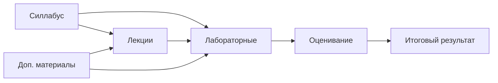

# Репозиторий курса "Введение в ОС Linux"

> Курс предназначен для студентов первого курса бакалавриата факультета прикладной информатики университета ИТМО. Задача курса - получение начальных знаний об архитектуре ОС на ядре Linux, об основных аспектах управления вычислительными ресурсами системы и приложениями, формирование навыков работы с командной строкой Linux, управления ресурсами системы, использования Linux как платформы запуска сетевых сервисов, управления базовыми настройками безопасности ОС

## Быстрая навигация

| Раздел                                | Назначение                                                    |
|---------------------------------------|---------------------------------------------------------------|
| [Силлабус](syllabus/README.md)        | цели, результаты обучения, политика курса, календарь          |
| [Лекции](lectures/README.md)          | конспекты, материалы до/после занятия                         |
| [Лабораторные](labs/README.md)        | задания, критерии, шаблоны отчета                             |
| [Доп. материалы](materials/README.md) | справочники, статьи, практики                                 |
| [Оценивание](assessment/README.md)    | рубрики, контрольные точки, итоговая схема                    |
| [Метаданные](meta/README.md)          | соглашения по структуре и Markdown                            |
| [Решения](solutions/README.md)        | исходный код и отчеты обучающихся в рамках лабораторных работ |

## Как студенту воспользоваться репозиторием?

1. Студенту на основе этого репозитория создает создает свой собственный репозиторий, через механизм ответвления (Fork). 
2. Репозиторий студента должен быть или **публичным** или к нему должен быть предоставлен доступ преподавателю - автору исходного репозитория.
3. Студенты обновляют свою копию репозитория при пополнении исходного.
4. Студенты **в своих отдельных репозиториях**, созданных через ответвление, по выполнении практических и лабораторных работ размещают отчеты и артефакты в директории `solutions`. При размещении новых решений следует делать отдельную ветвь 
## Карта курса

